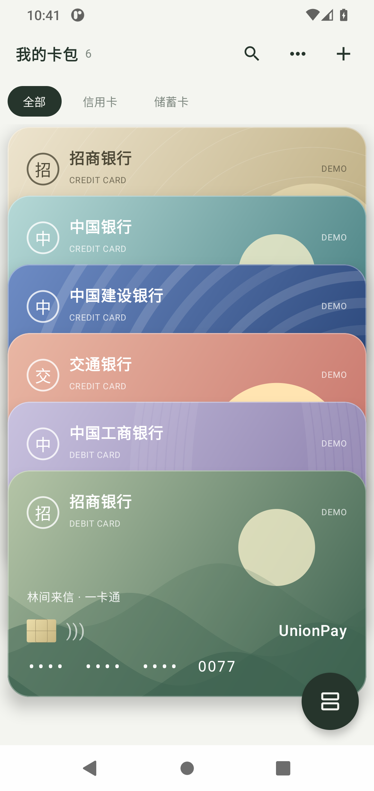
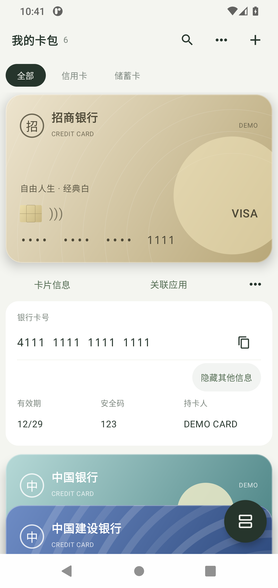

# 叠卡 DIÉKA（公开版）

[](LICENSE)

Kotlin + Jetpack Compose 编写的离线 Android APP，最低 Android 11（API 30）。

首次公开测试版：**v0.5.0**。前往 [下载页面](https://github.com/TeDaZui/dieka/releases/tag/v0.5.0) 获取 `dieka-v0.5.0-release.apk`，并对照 `SHA256SUMS.txt` 校验。下载的 APK 使用专属正式签名；本项目仍处于公开测试阶段。

公开版包名为 `io.github.tedazui.dieka`，应用名称为“叠卡（公开版）”。它与早期自用版 `com.dieka.wallet` **可以同时安装，卡库相互独立**，不会自动读取或迁移旧版卡片。请保留原应用及其数据。

首次启动显示公开 DEMO 虚拟卡片；添加自己的卡片需要设置设备锁屏凭据。验证结果与已知限制见 [TESTING.md](TESTING.md)，历史更新见 [CHANGELOG.md](CHANGELOG.md)。

## DEMO 截图

以下截图仅包含内置虚拟卡片，不含真实个人卡库。

<p>
  
  
</p>

## v0.5.0

- 单张卡片在原位置展开，不强制滚动到列表顶部，下方卡片随展开让位。
- 上下切卡由同一拖动进度驱动当前卡、相邻卡和列表位置，松手后连续弹簧落位，支持落位途中再次拖动；首尾仍不循环。
- 优化布局切换、大小变化、信息区、应用选择、更新日志及弹窗进退场过渡。
- 卡片下方改为“卡片信息 / 打开应用（未关联时为关联应用）/ ⋯”。编辑与移除位于三点旁的两项小菜单。
- 从手机中选择可启动的应用，默认使用检测到的应用名称，也可自定义按钮名称。长按快捷按钮或进入卡片编辑页可更换、改名或解除关联。
- 关联应用保存及跳转返回保留选中卡片、信息区和浏览位置；搜索、分类、布局与选中卡片也可在系统重建界面后保留。超时锁定规则继续生效。
- 更多 → 更新日志查看 0.1.0 至当前版本的更新记录。
- 切卡落位、排序落位、复制成功触发轻触反馈；更多 → 轻触反馈可关闭并记住设置，同时尊重系统触觉反馈设置。

应用关联信息随卡片加密保存，删除撤销和回收站恢复也保留关联。仅声明启动器 Intent 查询，不申请读取全部安装包或震动权限。

## 保留的卡包功能

- 首页保留紧凑工具栏、分类、搜索和右下角圆形布局按钮；允许截图和系统近期任务预览。
- 全部展开为单列小卡，更多 → 卡片大小可选每屏约 3／4／5 张，默认 4 张，自动记住选择。文字、图案、图片整体等比例缩放。
- 单击卡片在卡包中展开，再次点击卡面收起。在已展开的卡面上上下滑动切换相邻卡，遵循当前筛选和自定义顺序，首尾回弹。
- 信息区直接显示完整卡号，一键复制纯数字。有效期、安全码、持卡人统一显示／隐藏，显示 30 秒后自动隐藏；短暂切后台保留浏览位置并隐藏其他字段。
- 图片导入先裁剪再确认，支持银行卡比例／自由比例、边角调整、移动、双指缩放、90°旋转与重置。取消保留旧卡面和表单；最终图片最长边不超过 1200 像素，JPEG 85，完整等比例展示且不叠字。
- 内置卡面的文字仍在卡面对应位置独立编辑，不从银行卡资料自动填充。
- 到期日按填写月份最后一天计算。在剩余 7 天至当天显示一条窄横幅，覆盖全部正常卡片，不受筛选影响；支持多卡提示与列表定位。
- 移除无需确认，保存成功后显示“已移除　撤销”。更多 → 回收站可恢复最近七天的卡片；恢复优先回到原邻卡位置，阻止重复卡号。
- 回收站与正常卡片一起加密保存。旧数组卡库可直接读取，下次成功写入迁移为版本化快照，密钥及加密封装不变，失败保留旧文件。
- 保留拖动／长按排序、边缘滚动、辅助功能上移下移、搜索分类、按压回弹和弹层过渡。

## 存储与会话

Android Keystore AES-256-GCM 加密正常卡片、回收站、卡面及应用关联，随机 IV、完整性验证、原子写入；不申请联网权限，禁用云备份与设备迁移。展示大小与触觉反馈开关单独保存在偏好设置中。

首次创建／冷启动需系统验证，约五分钟内复用授权；前台超出密钥授权窗口后的下次写入需再验证。短暂离开应用保留浏览位置，后台超过五分钟自动锁定，也可从更多菜单主动锁定。回收站记录在移除七天后不可恢复，在下一次解锁读取或已授权写入时清理。

## 构建

使用 Android Studio 打开本目录，配置 JDK 17 和 Android SDK 35：

```powershell
.\gradlew.bat :app:assembleDebug :app:testDebugUnitTest
```

APK 输出：`app/build/outputs/apk/debug/app-debug.apk`。配置自己的 Android SDK 路径即可；仓库不包含工具链、模拟器、缓存、私钥或个人数据。

正式构建：`.\gradlew.bat :app:assembleRelease`，产生未签名 APK。正式发布需另行使用仓库外保存的发布密钥签名，操作说明见 [docs/RELEASING.md](docs/RELEASING.md)。调试版和官方正式版签名不同，不可直接互相覆盖。

Android 测试使用全新专用模拟器和公开虚拟卡号。实际 Keystore 测试需要显式 opt-in，详见 TESTING.md，不在个人卡库上运行。

## 代码结构

```text
app/src/main/java/com/dieka/wallet/
  MainActivity.kt          系统身份验证与生命周期
  WalletViewModel.kt       卡包状态、加密存取、会话与日期刷新
  data/BankCard.kt         卡片及独立卡面资料
  data/VaultSnapshot.kt    回收站、七天期限、原位置恢复
  data/VaultCodec.kt       版本化快照及旧数组兼容
  data/VaultStore.kt       Keystore 与原子存储
  data/VaultCipher.kt      AES-GCM 加密封装
  data/ExpiryPolicy.kt     月末到期与提醒边界
  data/CropGeometry.kt     旋转后的裁剪坐标换算
  data/InstalledApps.kt    可启动应用查询与跳转
  data/DeckMotion.kt       连续展开权重和切卡落位规则
  data/ReleaseNotes.kt     各版本更新内容
  ui/WalletApp.kt          首页、菜单、到期列表与回收站
  ui/CardBrowser.kt        小卡列表、原位展开、滑动切卡与复制
  ui/CardFace.kt           独立卡面及整体缩放
  ui/CardEditor.kt         资料与卡面编辑
  ui/CardCropper.kt        裁剪交互与后台图像处理
  ui/CardSort.kt           自定义排序及边缘滚动
  ui/AppLinkSheet.kt       应用选择、名称与关联编辑
  ui/Haptics.kt            可关闭的轻触反馈
  ui/Motion.kt             按压、弹窗和面板过渡
```

## 升级与边界

公开版是独立应用，不能覆盖或迁移原自用版卡库。后续公开版更新应使用同一发布签名并提升版本号；不要为了更换签名而卸载存有卡片的应用。源代码仍使用 `com.dieka.wallet` 作为 Kotlin 命名空间，这不影响独立的 Android 应用包名。

本应用不含银行账户绑定、支付、交易查询、云同步、备份、标签或双面卡图。卡号手动输入，长度校验不代表银行真实性校验。内置图案为原创抽象装饰，图片可自行导入。

卸载、清除数据或重置设备锁屏可能导致加密卡库无法恢复。专业安全审计和更多真实机型适配尚未完成。

实现参考：[Android 剪贴板文档](https://developer.android.com/develop/ui/views/touch-and-input/copy-paste)、[ImageDecoder](https://developer.android.com/reference/android/graphics/ImageDecoder)、[身份验证与 Keystore](https://developer.android.com/identity/sign-in/biometric-auth)、[应用可见性](https://developer.android.com/training/package-visibility/declaring)、[触觉反馈](https://developer.android.com/develop/ui/views/haptics/haptic-feedback)。


## 许可与反馈

原创项目代码以 [MIT](LICENSE) 许可发布，署名 `2026 TeDaZui`。第三方组件仍遵循各自许可证，见 [THIRD_PARTY_NOTICES.md](THIRD_PARTY_NOTICES.md)。本项目与示例中的银行、卡组织没有隶属或合作关系。

问题和改进建议请提交 [Issues](https://github.com/TeDaZui/dieka/issues)。请不要在公开 Issue、截图或日志中上传真实卡号、持卡人、安全码或卡库文件。
